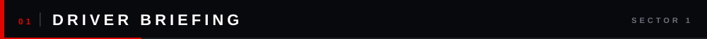
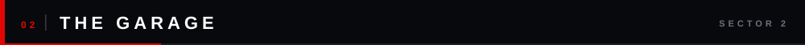
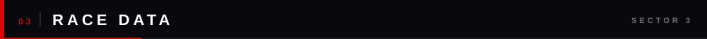
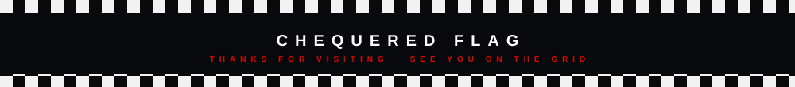
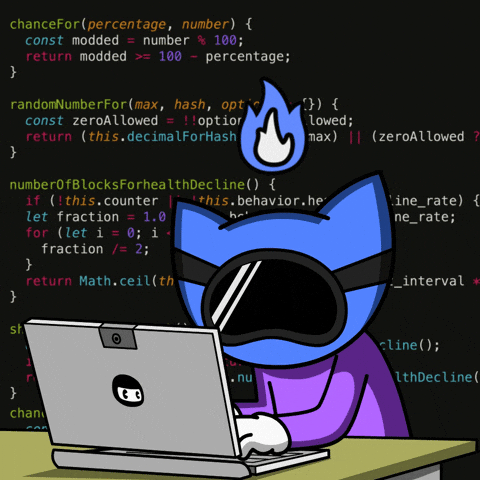

<<<<<<< HEAD

 

| | |
|---|---|
| 🏁 **Driver** | Naivedhya Jain |
| 🏎️ **Team** | Full-Stack Racing · Open Source |
| 📍 **Circuit** | India |
| 🔧 **Specialty** | Full-Stack Web Dev · DSA · Open Source |
| 🎯 **Current Race** | Building scalable web apps & cracking DSA |
| 🌐 **Pit Wall** | [naivedhyajain.engineer](https://naivedhyajain.engineer/) |
| 📫 **Team Radio** | naivedhyajain1234@gmail.com |

### 🔗 COMMUNICATIONS ARRAY

&nbsp;

&nbsp;

=======

  

###

<h3 align="left">👤  A Developer who loves building clean & user-friendly web apps.</h3>

###

 

###

🔭 I’m currently working on • Full-Stack Web Development projects • Data Structures & Algorithms (DSA) • Working on Open Source projects.

###

🌱  Learning & 🤝 Collaboration  • Exploring emerging technologies and modern    tools. • Enjoy collaborating with teams to develop efficient and impactful applications.

###

  

###

<h2 align="left">🚀 Portfolio</h2>

  

###

<h2 align="left">💻 Tech Stack:</h2>

  
  
  
  
  
  
  
  
  
  
  
  
  
  
  
  
  
  
  
  
  
  
  
  
  
  
  
  
  
  
  
  
  
  
  
  
  
  
  
  
  

###

## GitHub Stats
 

  
  

###

<h2 align="left">🔗 Connect With Me :</h2>

  
  

###

>>>>>>> origin/main

  Website Built & Designed with ❤️ by 
  <strong style="color:#8B0000;">NAIVEDHYA JAIN</strong>

<<<<<<< HEAD
###
=======
###

<!--  -->

###
>>>>>>> origin/main
